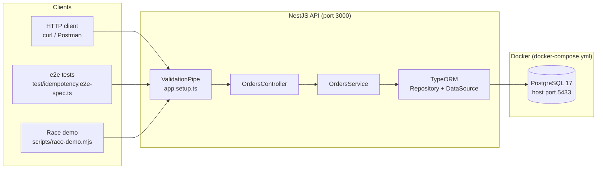
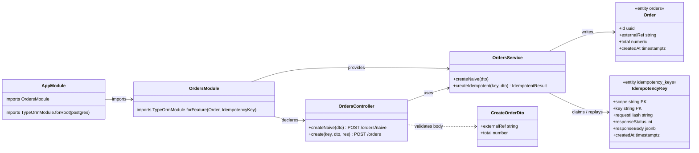
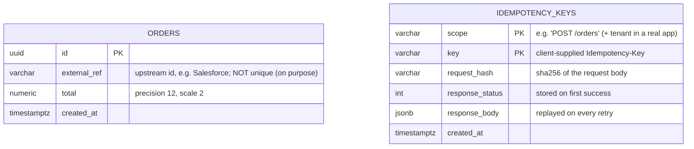
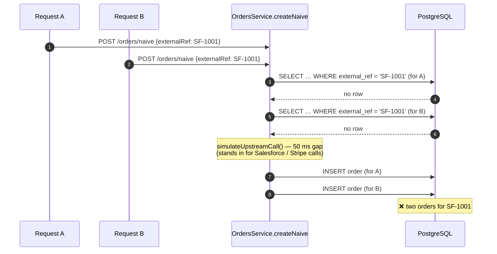
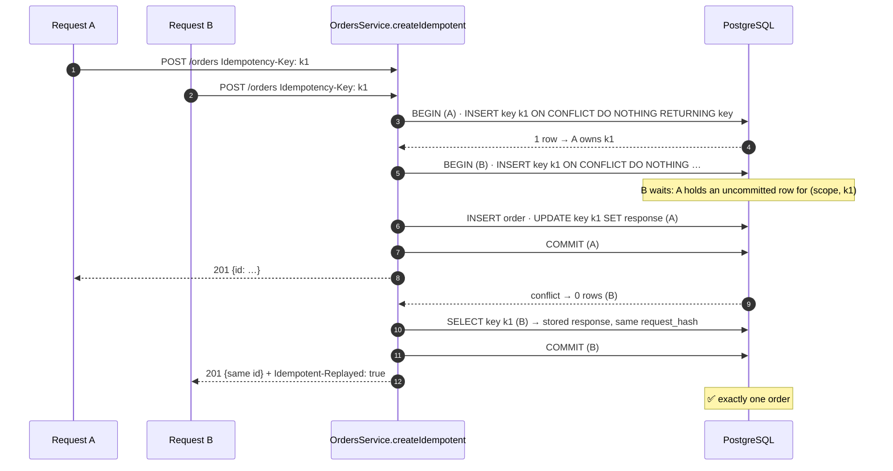
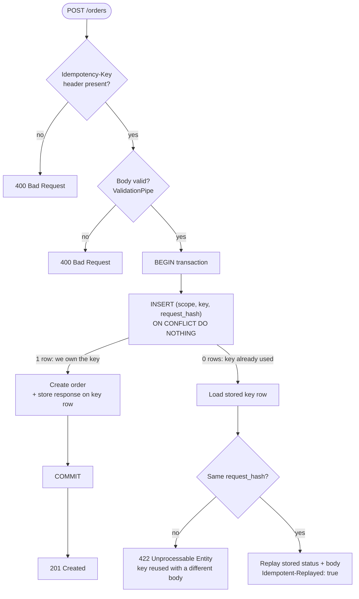

# Architecture — Order Ops Copilot

A small NestJS + PostgreSQL service used to practise **distributed correctness**.
Right now it exposes two ways to create an order:

| Endpoint | What it shows |
|---|---|
| `POST /orders/naive` | The bug: check-then-insert creates duplicates under concurrency |
| `POST /orders` (with `Idempotency-Key`) | The fix: the database decides who goes first; retries get the same response |

---

## 1. System overview

- **ValidationPipe** rejects bad bodies before they reach the controller (unknown fields, negative totals, missing `externalRef`).
- **OrdersController** handles HTTP concerns only: reading the `Idempotency-Key` header, setting the status code and the `Idempotent-Replayed` header.
- **OrdersService** holds the business logic and the transaction.
- **PostgreSQL** runs in Docker and is the source of truth for "who claimed this key first".

---

## 2. NestJS modules and classes

---

## 3. Data model

There is no foreign key between the tables: the stored `response_body` already contains the order id.
The **composite primary key `(scope, key)`** is the whole trick. Postgres allows only one transaction to insert a given pair.

---

## 4. The bug: `POST /orders/naive`

Two requests for the same upstream order arrive together. Both check, both see "not found", both insert.

The race demo shows it at scale: **20 concurrent requests → 20 orders**.

---

## 5. The fix: `POST /orders` with `Idempotency-Key`

Everything happens inside **one database transaction**. The second request is not rejected; Postgres makes it **wait** on the primary key until the first transaction finishes, then it reads the stored response.

### Decision flow inside `createIdempotent`

---

## 6. Folder map

| Path | Role |
|---|---|
| `src/main.ts` | Boots the app on `PORT` (default 3000) |
| `src/app.setup.ts` | Global `ValidationPipe`, shared by `main.ts` and the e2e tests |
| `src/app.module.ts` | Root module; TypeORM connection (env vars, defaults match Docker) |
| `src/orders/orders.controller.ts` | HTTP layer: header check, status code, replay header |
| `src/orders/orders.service.ts` | Naive path, idempotent path, request fingerprinting |
| `src/orders/order.entity.ts` | `orders` table |
| `src/orders/idempotency-key.entity.ts` | `idempotency_keys` table with composite primary key |
| `src/orders/create-order.dto.ts` | Request body rules (class-validator) |
| `test/idempotency.e2e-spec.ts` | Fires 20 concurrent requests against real Postgres |
| `scripts/race-demo.mjs` | Prints naive vs idempotent results against a running API |
| `docker-compose.yml` | PostgreSQL 17 on host port 5433 with a named volume |

---

## 7. Known limits (next lessons)

| Limit | Why it matters | Lesson |
|---|---|---|
| The whole operation runs in one DB transaction | Can't hold a transaction open around a Stripe or Salesforce call; needs an *in-progress* state and recovery | `/idempotency` 2 |
| `orders.external_ref` has no unique constraint | A second safety net at the business-key level | `/idempotency` 3 |
| No expiry on `idempotency_keys` | The table grows forever; keys usually expire after 24–72 h | `/idempotency` 2 |
| `scope` is a fixed string | In a multi-tenant API it must include the client or tenant id | `/idempotency` 2 |
| No outbox | Events to other systems can be lost or sent twice | `/idempotency` 6 |
| `synchronize: true` | Fine for learning; production uses migrations | — |
